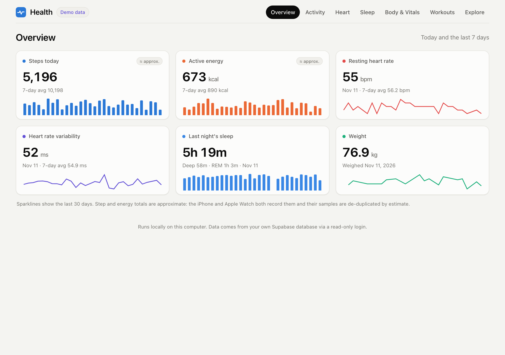
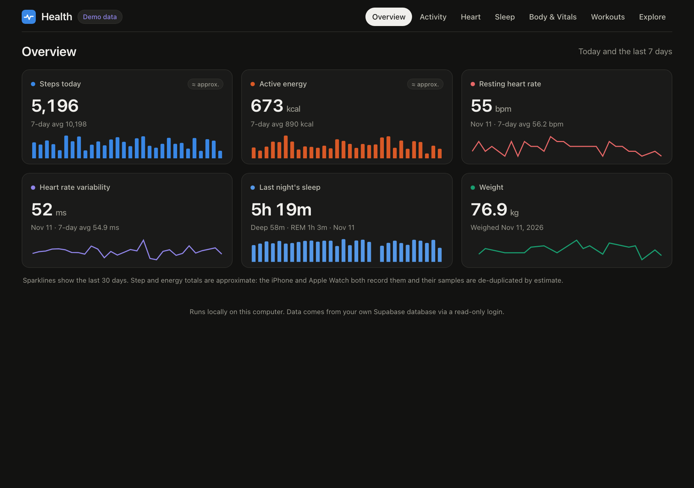
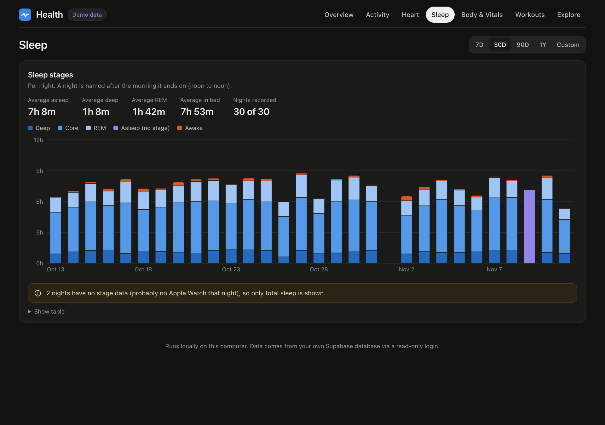
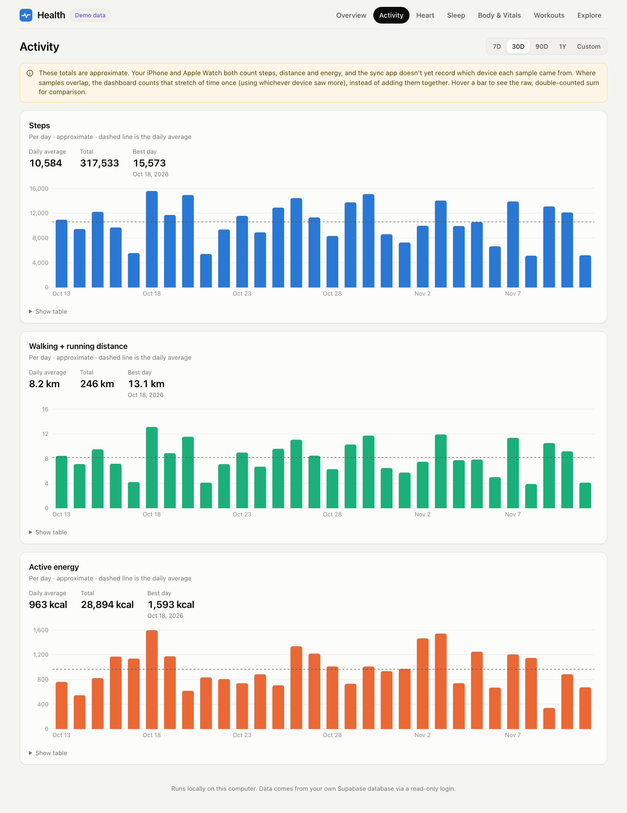
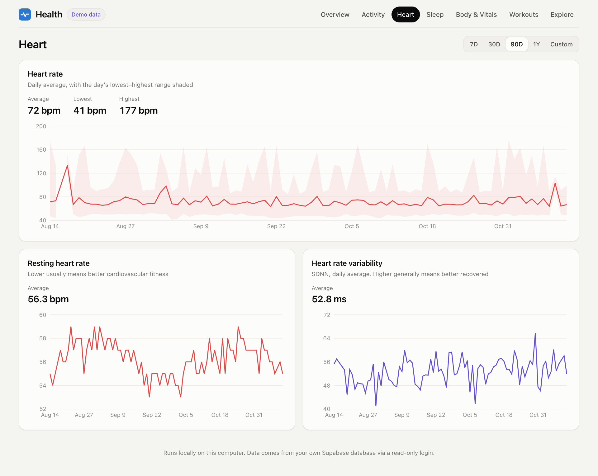
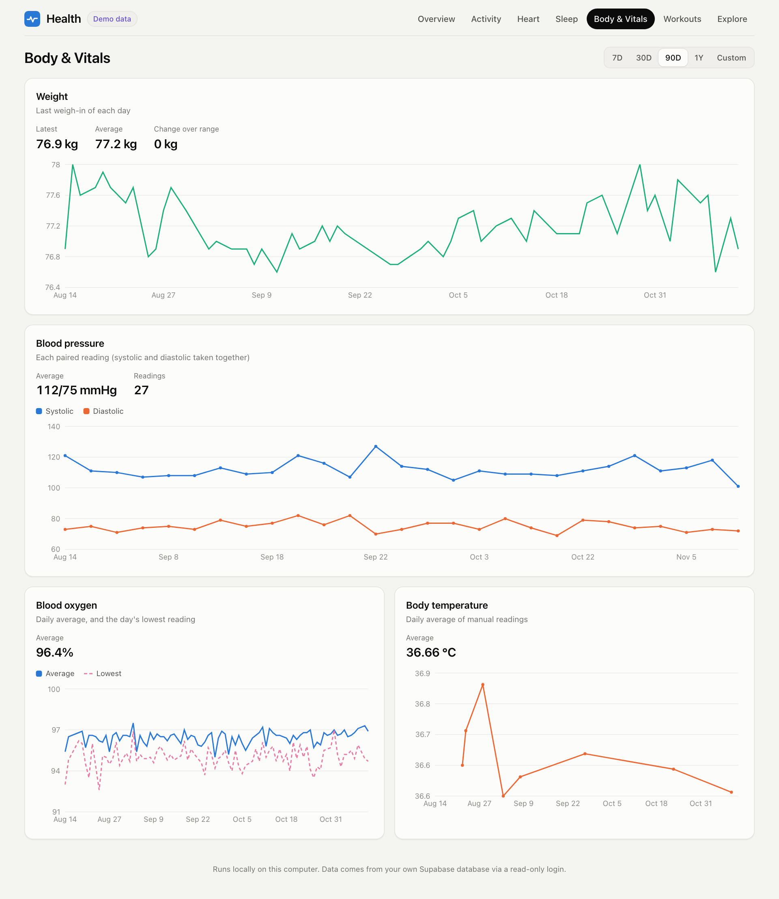
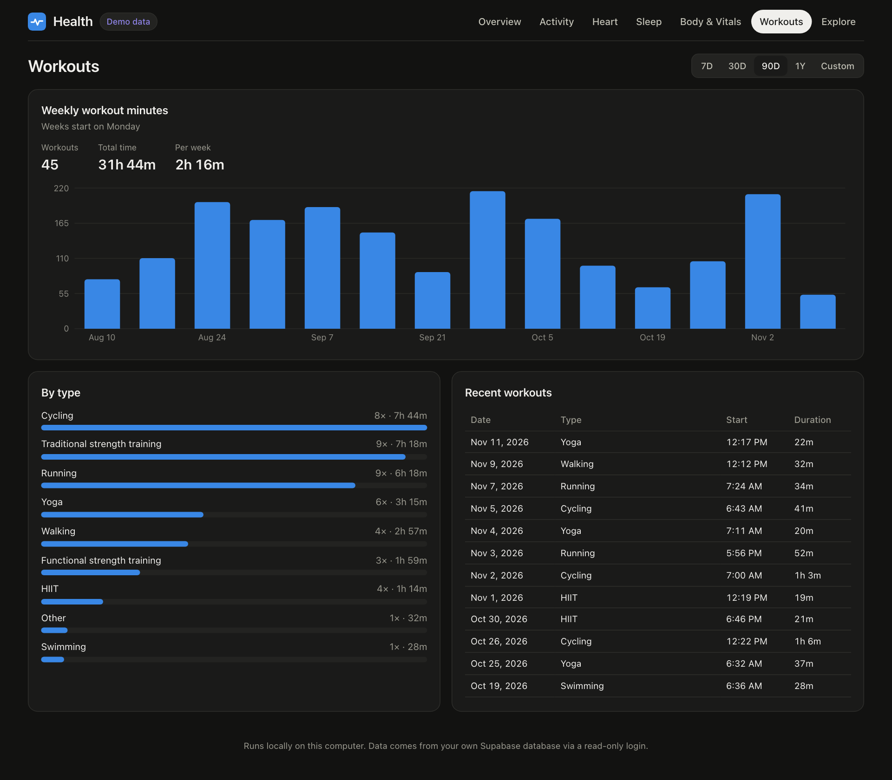
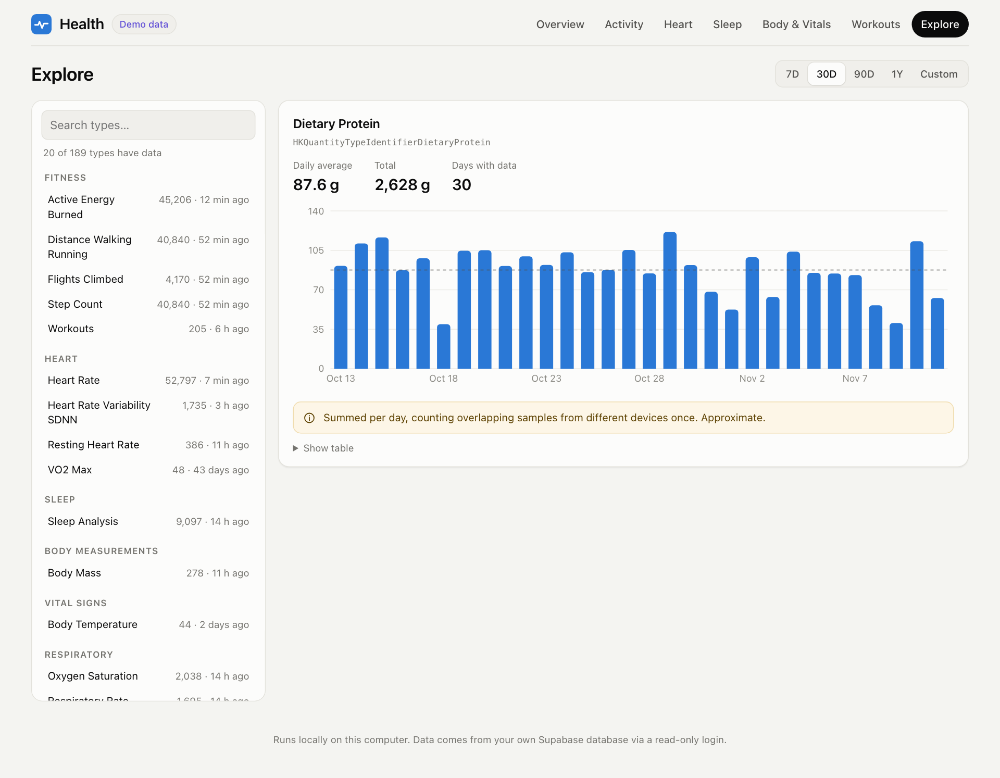

# My Personal Dashboard

My Apple Health data, in a database I own, with a dashboard that runs on my own Mac.

There are two halves to this repo:

- **[`apple-health-sync/`](./apple-health-sync)**: a small iPhone app that quietly copies Apple Health data (all 189 sample types: activity, heart, sleep, nutrition, symptoms, vitals and the rest) into my own Supabase Postgres database, in the background. It has its own README with the full setup.
- **[`dashboard/`](./dashboard)**: a local web dashboard to explore that data. It's a small Python API and a React page, both running on `127.0.0.1`, reading the database through a login that can only read.

I built it because I wanted my health data somewhere I control and can query, without a subscription and without it passing through anyone else's servers. This repo used to hold an older WHOOP dashboard. I don't use WHOOP any more, so I removed that code. It's still in the git history if you want it.

---

## Screenshots

These come from demo mode, so the numbers are made up.

| Overview | Overview (dark) |
|---|---|
|  |  |

| Sleep stages | Activity |
|---|---|
|  |  |

| Heart | Body & Vitals |
|---|---|
|  |  |

| Workouts | Explore (any synced type) |
|---|---|
|  |  |

## Try it in two minutes (demo mode)

You don't need a database, an iPhone, or any credentials for this. Demo mode serves about a year of realistic, made-up data. It's generated the same way every time, and it's messy on purpose (overlapping iPhone and Watch samples) so the clean-up logic has something to do.

You need Python 3.11+ and Node 20.19+ (on a Mac: `brew install python@3.12 node`).

```bash
git clone https://github.com/vishalkotak/my-personal-dashboard.git
cd my-personal-dashboard
DEMO=1 ./dashboard/start.sh      # first run installs dependencies, then prints the URL
open http://localhost:5173
./dashboard/stop.sh              # when you're done
```

Or from `dashboard/`: `make demo`, `make dev`, `make stop`, `make test`.

## Connecting it to your real data

This assumes the iPhone app is already syncing into your Supabase project (see [its README](./apple-health-sync/README.md)).

1. **Create the read-only login.** Make a strong password with `openssl rand -hex 32`. (`-hex` gives you only 0–9 and a–f, so it never needs URL-escaping. `openssl rand -base64 32` works too, but then you have to URL-encode `/`, `+` and `=`.) Open [`dashboard/sql/readonly_role.sql`](./dashboard/sql/readonly_role.sql), paste the password where it says `REPLACE_WITH_A_STRONG_PASSWORD`, and run the file in Supabase → SQL Editor. Afterwards, close the tab without saving it, so the password doesn't sit in your saved snippets. The script refuses to run while the placeholder is still there.
2. **Create `dashboard/.env`** from the example. It's gitignored.
   ```bash
   cp dashboard/.env.example dashboard/.env
   ```
   Set `DATABASE_URL` to the **session pooler** address:
   ```
   postgresql://healthsync_reader.<project-ref>:<password>@aws-0-<region>.pooler.supabase.com:5432/postgres?sslmode=require
   ```
   You'll find `<project-ref>` and `<region>` under Project Settings → Database → Connection string → *Session pooler*. Two gotchas: on the pooler, the username for a custom role is `<role>.<project-ref>`, not just the role. And the free tier's *direct* connection is IPv6-only, which a lot of home networks can't reach. The pooler works over IPv4.
   Set `TZ_NAME` to your time zone (default `America/Los_Angeles`). Days and nights are counted in it.
3. **Start it:** `./dashboard/start.sh`, then open http://localhost:5173. The pill next to the title tells you whether the database is reachable and when the phone last uploaded something.

## How it fits together

```
iPhone (HealthKit) ──HealthSync app──▶ Supabase Postgres: public.health_samples
                                              │  (one row per raw HealthKit sample)
                                              │  read-only login: healthsync_reader
                                              ▼
              dashboard/backend  (FastAPI, 127.0.0.1:8000, GET only)
                 • psycopg 3 pool, every query parameterized, 15 s statement timeout
                 • per-day aggregation in SQL, in your time zone
                 • de-duplication of overlapping samples in a small, pure, tested module
                                              │  /api/...
                                              ▼
              dashboard/frontend (React + Vite + Recharts, 127.0.0.1:5173)
```

- **Backend** (`dashboard/backend/app/`): `api.py` holds the routes, `service.py` shapes the responses, `dedupe.py` has the overlap and sleep logic (no I/O, lots of tests), `queries.py` builds the SQL, `sources.py` is either Postgres or the in-memory demo data, `catalog.py` reads the app's list of types, and `demo.py` makes the synthetic data.
- **Endpoints:** `/api/health`, `/api/summary?days=7`, `/api/daily?type=steps&from=&to=`, `/api/sleep`, `/api/workouts`, `/api/heart`, `/api/body`, plus `/api/types` and `/api/metric?type=<any HealthKit id>` for the Explore tab. `from`/`to` are local dates, both included, and a range can be at most 3 years. Interactive docs are at http://localhost:8000/api/docs.
- **Every type, not just the curated ones.** The iPhone app ships its type list as `apple-health-sync/HealthSync/HealthTypes.json` (id, group, name, unit, and whether it's a `sum`, `average` or `duration`). The dashboard reads that same file, and it doubles as the allowlist. Explore lists every type that has rows and charts it the right way: daily totals for things that add up (steps, water, protein, exercise minutes), daily average and range for measurements (VO2 max, respiratory rate), and time plus count for events (mindful sessions, symptoms, broken down by severity). Percent types are stored as fractions (0.97), so they're shown ×100. Nutrition is stored in grams and scaled to mg or µg when the amounts are small. If the catalog file is missing, it falls back to a built-in list plus whatever types it finds in the data.
- **Sleep** is grouped into nights from noon to noon, and each night is named after the morning it ends on. So a sleep that ends on Tuesday morning is "Tuesday's night", and so is an early nap on Monday evening. An afternoon nap that ends after noon counts towards the following night. That's a known trade-off of the noon cut-off.

## The double-counting caveat (please read)

The iPhone app uploads every raw sample from **every** source (the iPhone itself *and* the Apple Watch), but not which device each one came from. If you walk with both, both record the same steps. A plain `SUM(value)` would count them twice. In the demo data, which copies that pattern, the raw sum is often 30–80% too high.

Apple's Health app gets around this by choosing one source at a time from a priority list. Without the source, the dashboard does the next best thing:

- **Steps, distance, energy, and every other type that adds up:** time is cut into small slices at every sample boundary. Within each slice, a sample's value is assumed to be spread evenly over its own duration. When samples overlap, the dashboard takes the **largest** of their rates instead of adding them together. For a single device, that's exactly the plain sum. For two devices, the overlapping stretch is counted once, using whichever device saw more. It can come out a little high compared with Apple (it takes the max rather than a fixed priority), which is why those numbers are labelled **approximate** everywhere, and why hovering a bar shows the raw, double-counted sum next to it.
- **Sleep:** samples from several sources can overlap too, like the iPhone's coarse "in bed" block and the Watch's stages. Each slice gets the most specific label available: deep > REM > core > awake > asleep (no stage) > in bed. "In bed" is the union of everything.
- **Blood pressure:** systolic and diastolic readings are paired when they share exactly the same timestamp. Readings without a partner are counted and mentioned, but not plotted.

**The proper fix** is for the iPhone app to also upload `sample.sourceRevision.source.bundleIdentifier`, and then pick one source per type the way Apple does. I haven't changed the app for this yet. It's a small change in `SampleMapper.swift` plus a column.

## Security notes

- **Read-only, three times over.** The database role only has `SELECT` on `health_samples`, with no insert, update, delete or truncate grants, and every one of its sessions defaults to read-only. The backend sets read-only and a statement timeout on each connection as well. And the API only has GET routes, which a test checks.
- **It can read every row.** The RLS policy for `healthsync_reader` is `using (true)`, so it sees every user's rows in the table, not just yours. For a personal, single-owner Supabase project that's what you want (it even picks up rows from an older anonymous account if the app ever had to start a new one). If you ever share the project, set `HEALTH_USER_ID` in `.env` or tighten the policy.
- **Local only.** Both servers bind to `127.0.0.1`. The API rejects requests addressed to any other host name (which guards against DNS-rebinding tricks), and CORS only allows the local frontend. There are no CDNs, web fonts or analytics, and nothing in the page talks to anything except the local API.
- **Inputs are checked.** Types must be in the catalog, dates must parse, and a range can't run backwards or be longer than 3 years. All SQL is parameterized, and error messages never include connection details.
- **No secrets in git.** `dashboard/.env` and any `*.db` file are gitignored, and only `.env.example` is committed. Dependencies are pinned exactly (`requirements.txt` with the full transitive set, and `package-lock.json`).
- Tests that run the real SQL, including `readonly_role.sql` on a Supabase-like Postgres where the owner isn't a superuser, are in `dashboard/backend/tests/test_integration_pg.py`. Run them with `make test-integration` (needs Docker).

## Development

```bash
cd dashboard
make test               # backend unit tests (pytest) + frontend typecheck and tests (vitest)
make test-integration   # Postgres 17 in Docker: role permissions, and SQL vs Python results
make build              # production build of the frontend
```

To regenerate the screenshots, start demo mode with a pinned clock (`DEMO=1 DEMO_NOW=2026-11-11T18:30:00-08:00 ./dashboard/start.sh`) and run `python dashboard/scripts/screenshots.py`. That needs Playwright installed somewhere.

## License

MIT, see [LICENSE](LICENSE). It covers the whole repository: the iPhone app and the dashboard. Use it, fork it, make it yours.
